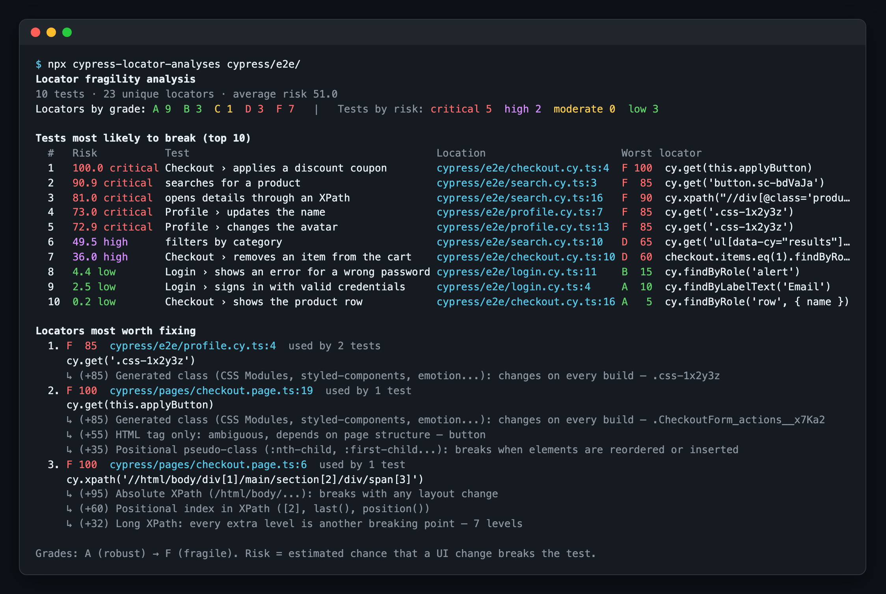
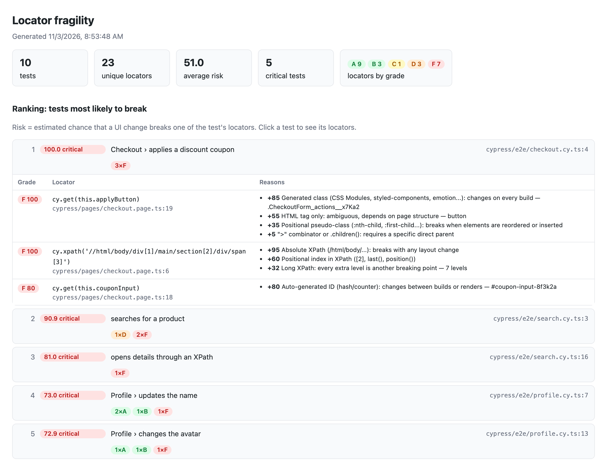

# cypress-locator-analyses

[](https://www.npmjs.com/package/cypress-locator-analyses)
[](https://github.com/laerteneto/cypress-locator-analyses/actions/workflows/ci.yml)
[](https://github.com/laerteneto/cypress-locator-analyses/blob/main/LICENSE)

Selector fragility analysis for Cypress. It works as a **plugin** (runs after `cypress run`) and as a **linter/CLI** (runs without executing tests, which makes it a good fit for CI).

Every locator gets a grade from **A (robust)** to **F (fragile)**. Every test then gets a **risk score from 0 to 100**, and the result is a ranking of the tests most likely to break and of the locators most worth fixing.

The Playwright version of this tool is [playwright-locator-analyses](https://github.com/laerteneto/playwright-locator-analyses).

### Console output

The ranking printed by the CLI and the plugin, run on the [example project](https://github.com/laerteneto/cypress-locator-analyses/tree/main/example):



### HTML report

With `htmlFile` (plugin) or `--html` (CLI), you get a report you can browse. Click a test to see each locator, its grade and the reasons behind it:



## How it works

The analysis is **static**. It uses the TypeScript compiler to read your specs (JavaScript or TypeScript), so it needs no browser and no running app. It follows the code the way a developer would:

- **Query chains**: `cy.get('[data-cy=list]').find('li').eq(2)` is one locator. The chain continues through actions that keep the subject (`cy.get(a).click().find(b)`), and `cy.get()` starts a new one.
- **Page objects and helpers**: `loginPage.login()` counts the selectors used inside `login()`, even when it lives in another file. Getters (`get submit() { return cy.get(...) }`), methods that return a chain, element maps (`elements = { email: () => cy.get(...) }`) and selector strings in fields or constructors are resolved too.
- **Custom commands**: `Cypress.Commands.add()` in `cypress/support` is followed. `cy.getBySel('save')` is scored with its argument (`[data-cy=save]` → A), and a command like `cy.login()` counts every selector it uses. Child commands (`{ prevSubject }`) continue from the element they are chained on.
- **Aliases**: `cy.get('@rows').eq(1)` is scored from the locator saved with `.as('rows')`. Network aliases (`cy.intercept().as(...)`) are ignored.
- **`.within()`**: queries inside the callback are scoped to its subject.
- **Hooks**: selectors in `beforeEach`/`before` count for every test in the enclosing `describe`/`context`.
- **Constants**: `cy.get(SELECTORS.promo)` and template strings are resolved when possible.
- **Testing Library** (`cy.findByRole`, `findByLabelText`, ...) and **XPath** (`cy.xpath()`) are scored too.

When it runs as a plugin, it also shows whether each test **failed** or was **flaky** (passed after a retry) in that run, next to its risk.

## Installation

```bash
pnpm add -D cypress-locator-analyses
# or
npm i -D cypress-locator-analyses
# or
yarn add -D cypress-locator-analyses
```

## Usage as a plugin

```ts
// cypress.config.ts
import { defineConfig } from 'cypress';
import locatorAnalyses from 'cypress-locator-analyses';

export default defineConfig({
  e2e: {
    setupNodeEvents(on, config) {
      locatorAnalyses(on, config, {
        htmlFile: 'fragility-report.html',   // optional
        outputFile: 'fragility-report.json', // optional
        top: 10,
        // failOnRisk: 80,                   // fail `cypress run` if any test has risk >= 80
      });
      return config;
    },
  },
});
```

With CommonJS: `const { locatorAnalyses } = require('cypress-locator-analyses');`.

The analysis runs on the `after:run` event, so it runs with `cypress run` (and with `cypress open` only if `experimentalInteractiveRunEvents` is on).

Cypress keeps only **one** handler per event. If another plugin also uses `after:run`, call both from your own handler:

```ts
import { analyzeRun } from 'cypress-locator-analyses';

on('after:run', (results) => {
  otherPlugin(results);
  analyzeRun(results, config, { htmlFile: 'fragility-report.html' });
});
```

## Usage as a linter (CLI)

```bash
npx cypress-locator-analyses cypress/e2e                     # ranking in the console
npx cypress-locator-analyses cypress/e2e --html report.html  # plus an HTML report
npx cypress-locator-analyses cypress/e2e --fail-on-risk 80   # exit code 1 if any test has risk >= 80
```

`npx` downloads the tool if it isn't installed in your project, so you can try it without adding it first.

| Option | Description |
| --- | --- |
| `--json <file>` | Write the full report as JSON |
| `--html <file>` | Write a browsable HTML report |
| `--top <n>` | Number of tests in the ranking (default 10) |
| `--top-locators <n>` | Number of "locators worth fixing" to show (default 5) |
| `--fail-on-risk <0-100>` | Fail if any test has risk >= n |
| `--support <path>` | File or folder with custom commands (default: `cypress/support` of the project that holds the specs). Repeatable |
| `--tsconfig <file>` | tsconfig used to resolve imports/aliases (auto-detected) |
| `--test-id-attribute <attr>` | Custom test id attribute (e.g. `data-automation`) |
| `--pattern <regex>` | Test file regex (default `\.(cy\|spec\|test)\.[cm]?[jt]sx?$`) |

## Plugin options

| Option | Default | Description |
| --- | --- | --- |
| `outputFile` | — | JSON report path (relative to the project root) |
| `htmlFile` | — | HTML report path (relative to the project root) |
| `top` / `topLocators` | 10 / 5 | Size of the console lists |
| `failOnRisk` | — | Fail `cypress run` (exit code 1) if any test has risk >= value |
| `quiet` | `false` | Do not print to the console (only write files) |
| `weights` | — | Override the points of any rule, e.g. `{ 'nth-child': 50, text: 15 }` |
| `testIdAttributes` | — | Extra attributes treated as test ids (`data-cy`, `data-test`, `data-testid`, `data-test-id` and `data-qa` always are) |
| `supportFiles` | `config.supportFile` | Files with custom commands (their imports are followed) |
| `testFunctionNames` | `['it', 'specify']` | Names of your test function, if you use a different one |
| `hotspotMinScore` | 30 | Minimum score to appear under "locators most worth fixing" |

## Scoring

Each locator starts from the **most fragile anchor** it depends on (a CSS selector only matches if every part matches), and **penalties** are added on top. Scores range from 0 to 100.

| Anchor | Points | | Penalty | Points |
| --- | --- | --- | --- | --- |
| `[data-cy]` / `[data-testid]` / `findByTestId` | 5 | | `:nth-child`, `:first-child`... | +35 |
| `findByRole` with `name` | 5 | | jQuery `:eq()`, `:first`, `:gt()`... | +25 |
| `findByLabelText` | 10 | | `.eq(n)` | +25 |
| `findByRole` without `name` | 15 | | `.first()` / `.last()` | +15 |
| `cy.contains` / `:contains()` / `findByText` | 25 | | `.parent()`, `.siblings()`, `.next()`, `.closest()`... | +15 each |
| fixed `#id` | 20 | | XPath index `[2]`, `last()` | +20 each |
| HTML tag inside a known element (`.find('li')`) | 30 | | XPath deeper than 3 levels | +8 per level |
| semantic CSS class `.btn` | 35 | | axes `..`, `following-sibling` | +15 each |
| relative XPath | 40 | | CSS deeper than 2 levels | +7 per level |
| utility class `.mt-4` | 50 | | `>` / `.children()` / `+` `~` | +5 / +5 / +10 |
| tag only `button` | 55 | | text longer than 40 characters | +10 |
| generated `#id` (`:r1:`, `ember123`) | 80 | | | |
| generated class (`.css-1x2y3z`, `.Btn_x__a1B2c`, `.sc-bdVaJa`) | 85 | | | |
| absolute XPath (`/html/body/...`) | 95 | | | |

Grades: **A** < 15 ≤ **B** < 30 ≤ **C** < 50 ≤ **D** < 70 ≤ **F**.

### Test risk

A locator with score `s` is assumed to break on a UI change with probability `p = (s/100)²`. The test breaks if any of its locators breaks:

```
risk = 1 − Π (1 − pᵢ)
```

Squaring keeps tests full of good locators close to zero, while a single F locator already makes a test critical. Levels: **low** < 10 ≤ **moderate** < 25 ≤ **high** < 50 ≤ **critical**.

"Locators most worth fixing" are sorted by `(s/100)² × number of tests using the locator`, so a bad selector in a `beforeEach`, a page object or a custom command rises to the top.

## Ignoring a locator

```ts
// cypress-locator-analyses-ignore
cy.get('#legacy-widget-12345').click();
cy.get('.btn-legacy').click(); // cypress-locator-analyses-ignore
```

## Programmatic API

```ts
import { analyzeFiles, buildReport, formatConsole, scoreSelector, ScoreContext } from 'cypress-locator-analyses';

const report = buildReport(analyzeFiles(['cypress/e2e/login.cy.ts']));
console.log(formatConsole(report));

scoreSelector('div > li:nth-child(2)', new ScoreContext()).score; // 95 (F)
```

## Limitations

- The analysis is static: selectors built at runtime (from API responses, complex loops) are marked as "dynamic" (score 30).
- Custom commands are found by scanning for `Cypress.Commands.add()` in the specs, the support files and what they import. Commands added with `addQuery()` or `overwrite()` are not followed.
- Aliases are matched by name: the closest preceding `.as('name')` in the same file wins.
- Generated class and ID detection is heuristic. An unusual name may be misclassified; adjust `weights` or use the ignore comment.
- Parameterized tests (`[...].forEach((x) => it(...))`) appear once in the static ranking.
- Test outcomes are matched by spec file and title, so tests with dynamic titles show no outcome.

## Development

Development uses [pnpm](https://pnpm.io) (the version is pinned in `package.json`; run `corepack enable` to use it automatically) and Node 22 or 24. The published package supports Node 20+.

```bash
pnpm install
```

```bash
pnpm run build       # compile to dist/
pnpm run typecheck   # typecheck src, tests, the example and the e2e project
pnpm test            # build, then unit, plugin and CLI tests (vitest)
pnpm run example     # run the CLI on the example project (example/)
pnpm run e2e         # run real Cypress tests with the plugin (e2e/)
pnpm run e2e:verify  # check the JSON report written by the e2e run
pnpm run docs:images # regenerate the README screenshots in docs/images/ (uses playwright-core)
```

CI (`.github/workflows/ci.yml`) runs all of the above on Node 22 and 24 for every push to `main` and every pull request, checks that `failOnRisk` makes `cypress run` fail, and uploads the generated reports as artifacts. Dependabot (`.github/dependabot.yml`) checks npm packages and GitHub Actions weekly, with at most 5 open pull requests.
